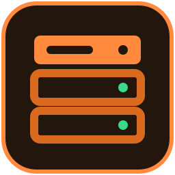
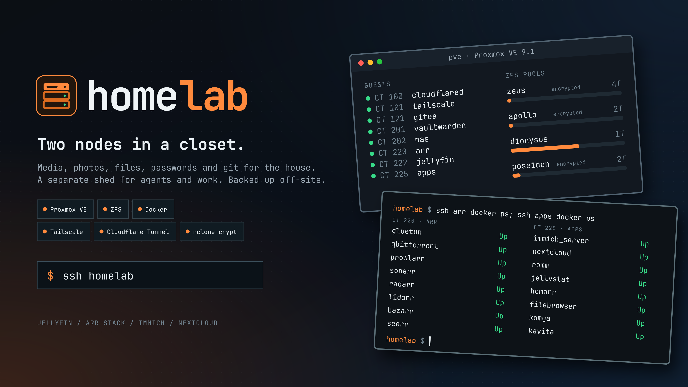
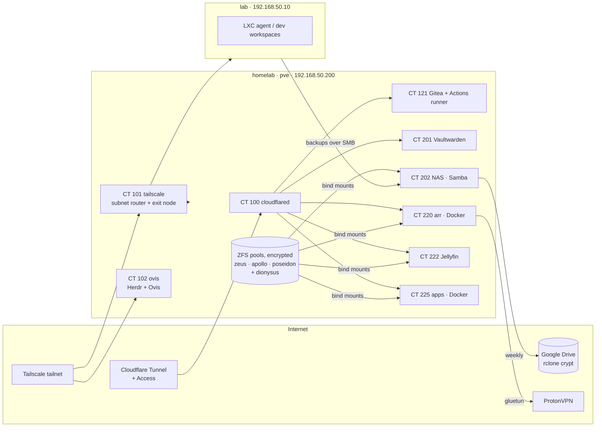

#  homelab

My self-hosted setup: two Proxmox nodes in a closet. The **homelab** runs media, photos, files, passwords and git for the house. The **lab** is my own workshop for AI agents and work dev environments. Everything is reachable from anywhere through Tailscale, and a few things are published through a Cloudflare Tunnel.

> Last reviewed: November 2026, right after the media rebuild (one big VM became three LXCs, and the data disks were wiped and re-created encrypted). This repo is a snapshot of what actually runs, not a tutorial. Secrets, `.env` files, hostnames and personal side projects are intentionally left out.

## Navigation

| Path | What's inside |
| --- | --- |
| [`pve/`](pve/) | The homelab node: host setup (one-passphrase unlock, alert mail, antivirus, stability) and a folder per guest |
| [`pve/ct-220-arr/`](pve/ct-220-arr/) | The arr stack behind a VPN, download rules, TRaSH quality profiles, API wiring scripts |
| [`pve/ct-222-jellyfin/`](pve/ct-222-jellyfin/) | Native Jellyfin |
| [`pve/ct-225-apps/`](pve/ct-225-apps/) | Immich, Nextcloud, RomM, Jellystat, Homarr, File Browser, Komga, Kavita, ClamAV |
| [`lab/`](lab/) | The second node: agent and dev workspaces |
| [`docs/storage.md`](docs/storage.md) | Encrypted ZFS pools and how storage reaches the guests |
| [`docs/backups.md`](docs/backups.md) | Weekly snapshots, the nightly vault replica and the encrypted off-site copy to Google Drive |

The infra guests (cloudflared, Tailscale, Ovis, Gitea, Vaultwarden, NAS) have their own short pages under [`pve/`](pve/).

## Architecture

Every guest is an **unprivileged LXC**. Storage reaches them as plain bind mounts of host ZFS datasets: no SMB, NFS or virtiofs in the data path. That makes hardlinks between downloads and the library work.

## Hardware

### homelab (`pve`): Proxmox VE 9.1

| Part | |
| --- | --- |
| CPU | AMD Ryzen 5 5600X (6C/12T) |
| Board | ASRock Fatal1ty B450 Gaming K4 |
| RAM | 32 GB DDR4 (4×8 GB) |
| GPU | GeForce GT 610, for console output only |
| Boot / guests | 240 GB SATA SSD (Proxmox and `local-lvm`) |
| Data | 4 TB IronWolf, 2 TB Seagate, 1 TB Toshiba, 2 TB WD Purple (one ZFS pool each, see [storage](docs/storage.md)) |

### lab: Proxmox VE 9.2

| Part | |
| --- | --- |
| CPU | AMD Ryzen 7 5700G (8C/16T, Vega iGPU) |
| Board | ASRock Fatal1ty X370 Gaming X |
| RAM | 16 GB DDR4 |
| Storage | 1 TB SATA SSD |

### Network

- TP-Link Archer AX10 router and a TP-Link gigabit switch, flat `192.168.50.0/24`
- Both nodes on 1 GbE (each has a second NIC that isn't in use yet)
- Every guest and the host resolve through Cloudflare DNS (`1.1.1.1`); the router serves no local names anyway

## Services

### Infrastructure (LXC on `pve`)

| Guest | Service | Role |
| --- | --- | --- |
| [CT&nbsp;100](pve/ct-100-cloudflared/) |  cloudflared | Cloudflare Tunnel for the few public endpoints, all behind Cloudflare Access, plus a small service that temporarily whitelists an IP. No ports are open on the router |
| [CT&nbsp;101](pve/ct-101-tailscale/) |  Tailscale | Subnet router and exit node: the whole LAN is reachable from my devices anywhere, and I can route traffic home on untrusted Wi-Fi |
| [CT&nbsp;102](pve/ct-102-ovis/) |  Ovis | Always-on Herdr server with the Ovis plugin, for agent sessions that outlive my laptop. Loopback only, reached over an SSH tunnel or its own Tailscale node |
| [CT&nbsp;121](pve/ct-121-gitea/) |  Gitea | Private git, plus a Gitea Actions runner for CI. Nightly `gitea dump` |
| [CT&nbsp;201](pve/ct-201-vaultwarden/) |  Vaultwarden | Password manager (Bitwarden-compatible) |
| [CT&nbsp;202](pve/ct-202-nas/) |  NAS | Samba shares (`data`, `stuff`, `backup`, `roms`) and the off-site backup jobs |

### Media and apps

| Guest | What runs there | Details |
| --- | --- | --- |
| [CT&nbsp;220&nbsp;arr](pve/ct-220-arr/) |  Sonarr,  Radarr, Lidarr, Bazarr, Prowlarr, FlareSolverr, Seerr, Recyclarr, and qBittorrent inside **gluetun** (ProtonVPN with port forwarding) | [`arr/`](pve/ct-220-arr/) |
| [CT&nbsp;222&nbsp;jellyfin](pve/ct-222-jellyfin/) |  Jellyfin, installed natively from the official repo (no Docker), read-only media | [`jellyfin/`](pve/ct-222-jellyfin/) |
| [CT&nbsp;225&nbsp;apps](pve/ct-225-apps/) |  Immich (with ML),  Nextcloud,  RomM, Jellystat,  Homarr, File Browser Quantum, Komga, Kavita, ClamAV | [`apps/`](pve/ct-225-apps/) |

### lab

LXC workspaces where coding agents (Claude Code, Codex, opencode) and work dev environments run in tmux/herdr sessions over SSH. Each workspace is its own container with its own resource limits. See [`lab/`](lab/).

## Security and monitoring at a glance

| What | How |
| --- | --- |
| Data at rest | `zeus`, `apollo` and `poseidon` are ZFS-encrypted (aes-256-gcm) under **one passphrase**, typed after each boot by [`homelab-unlock`](pve/). The guests that need the data stay down until then |
| Network | Proxmox firewall per guest: inbound DROP, then a LAN allow-list per port. Public endpoints only through the tunnel, behind Cloudflare Access |
| Downloads | VPN-only egress with a kill switch, executables and scripts never downloaded, release filters that drop fakes and obfuscated releases |
| Antivirus | Nextcloud scans every upload (clamd). A nightly ClamAV pass covers anything new in downloads, personal files and the cloud data |
| Alerts | SMART (nightly short test, monthly long test, temperature), ZFS events, backups and antivirus hits are all mailed through Proxmox notifications with a `[homelab]` subject prefix |

More in [`host/`](pve/).

## Backups at a glance

| What | Where | When |
| --- | --- | --- |
| All `pve` guests (vzdump, snapshot mode) | `poseidon` disk (encrypted), keeps the last 3 | Sunday 03:00 |
| Those archives, encrypted | Google Drive via `rclone crypt` | Sunday 09:00 |
| ROM library, encrypted | Google Drive via `rclone crypt` | Sunday 12:00 |
| `apollo/vault` (photos, Nextcloud, files) | Raw encrypted `zfs send` replica on `poseidon`, keeps 30 | Nightly 01:30 |
| Gitea | `gitea dump` inside the CT, kept 7 days | Nightly |
| lab workspaces | File-level archives to the NAS over SMB | Daily |

Media in `zeus` is not backed up on purpose: it can be downloaded again. More in [`backups/`](docs/backups.md).

## Roadmap

- [x] Encrypt the data pools (done in the November 2026 rebuild)
- [x] Replace the single media VM with per-role LXCs
- [ ] Nightly encrypted replica of `apollo/vault` (photos, cloud, personal files) to `poseidon`, then off-site
- [ ] Hardware transcoding for Jellyfin: move the 5700G (VA-API) into the homelab, which is one `dev0: /dev/dri/renderD128` line on CT 222
- [ ] Mirror the data pools. Each pool is one disk, so a dead disk means restoring from backup
- [ ] Comic and book downloaders (the readers are already running)
- [ ] More RAM and an NVMe for the lab
- [ ] Bigger and faster boot SSD for `pve`, since `local-lvm` is getting tight
