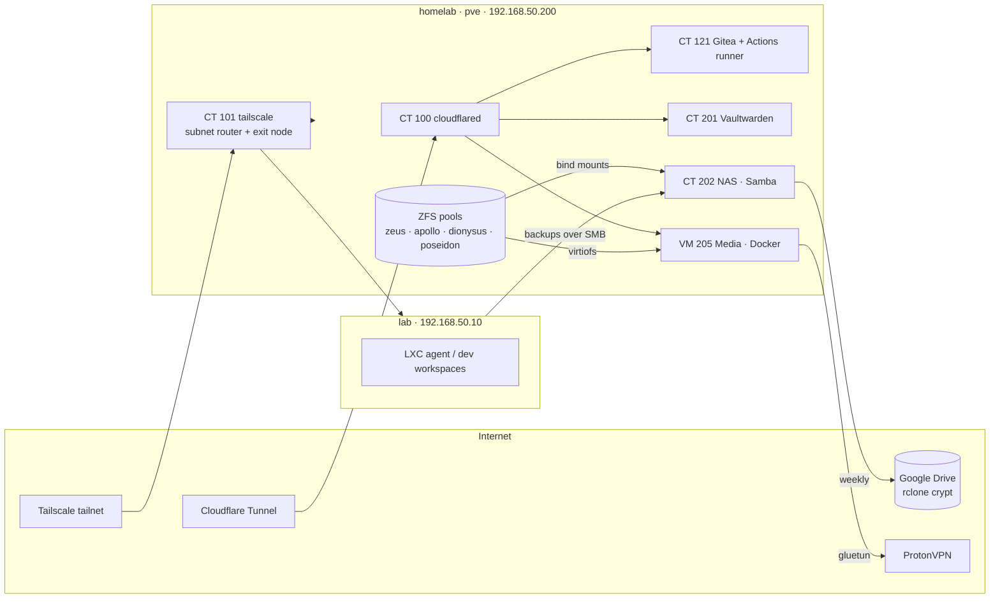

# homelab

My self-hosted setup: two Proxmox nodes in a closet. One is the **homelab**, which runs media, photos, files, passwords and git for the house. The other is the **lab**, my own workshop for AI agents and work dev environments. Everything is reachable from anywhere through Tailscale, and a few things are published through a Cloudflare Tunnel.

> Last reviewed: October 2026. This repo is a snapshot of what actually runs, not a tutorial. Secrets, `.env` files and personal side projects are intentionally left out.

## Navigation

| Folder | What's inside |
| --- | --- |
| [`media/`](media/) | Media VM: the arr stack behind a VPN, Jellyfin, requests, books/comics, file browser, dashboard |
| [`roms/`](roms/) | RomM retro game library |
| [`storage/`](storage/) | ZFS pools and how storage reaches the guests |
| [`backups/`](backups/) | Weekly snapshots and the encrypted off-site copy to Google Drive |
| [`lab/`](lab/) | The second node: agent and dev workspaces |

## Architecture

## Hardware

### homelab (`pve`): Proxmox VE 9.1

| Part | |
| --- | --- |
| CPU | AMD Ryzen 5 5600X (6C/12T) |
| Board | ASRock Fatal1ty B450 Gaming K4 |
| RAM | 32 GB DDR4 (4×8 GB) |
| GPU | GeForce GT 610, for console output only |
| Boot / guests | 240 GB SATA SSD (Proxmox and `local-lvm`) |
| Data | 4 TB IronWolf, 2 TB Seagate, 1 TB Toshiba, 2 TB WD Purple (one ZFS pool each, see [storage](storage/)) |

### lab: Proxmox VE 9.2

| Part | |
| --- | --- |
| CPU | AMD Ryzen 7 5700G (8C/16T, Vega iGPU) |
| Board | ASRock Fatal1ty X370 Gaming X |
| RAM | 16 GB DDR4 |
| Storage | 1 TB SATA SSD |

### Network

- TP-Link Archer AX10 router and a TP-Link gigabit switch, flat `192.168.50.0/24`
- Both nodes on 1 GbE (each has a second NIC that isn't in use yet)

## Services

### Infrastructure (LXC on `pve`)

| Guest | Service | Role |
| --- | --- | --- |
| CT&nbsp;100 |  cloudflared | Cloudflare Tunnel for the few public endpoints, plus a small service that temporarily whitelists an IP. No ports are open on the router |
| CT&nbsp;101 |  Tailscale | Subnet router and exit node: the whole LAN is reachable from my devices anywhere, and I can route traffic home on untrusted Wi-Fi |
| CT&nbsp;121 |  Gitea | Private git, plus a Gitea Actions runner for CI. Nightly `gitea dump` |
| CT&nbsp;201 |  Vaultwarden | Password manager (Bitwarden-compatible) |
| CT&nbsp;202 |  NAS | Samba shares over the ZFS datasets, and the off-site backup jobs |

### Media VM (VM 205: Debian, Docker)

| Stack | Containers |
| --- | --- |
| Playback |  Jellyfin, Jellyseerr (requests), Jellystat (stats) |
| Acquisition |  Sonarr,  Radarr, Lidarr, Bazarr, Prowlarr, Kapowarr, FlareSolverr |
| Downloads | qBittorrent inside **gluetun** (ProtonVPN), plus deunhealth to restart anything that goes unhealthy |
| Photos |  Immich |
| Cloud |  Nextcloud (Postgres + Redis) |
| Books / comics | Kavita |
| Retro games |  RomM, plus a small self-made ROM downloader (vimmslair) |
| Files | File Browser |
| Dashboard |  Homarr, which reads Docker through a read-only socket proxy |

Details and compose files are in [`media/`](media/) and [`roms/`](roms/).

### lab

LXC workspaces where coding agents (Claude Code, Codex, opencode) and work dev environments run in tmux/herdr sessions over SSH. Each workspace is its own container with its own resource limits. See [`lab/`](lab/).

## Backups at a glance

| What | Where | When |
| --- | --- | --- |
| All `pve` guests (vzdump, snapshot mode) | `poseidon` disk, keeps the last 3 | Sunday 03:00 |
| Those archives, encrypted | Google Drive via `rclone crypt` | Sunday 09:00 |
| ROM library, encrypted | Google Drive via `rclone crypt` | Sunday 12:00 |
| Gitea | `gitea dump` inside the CT, kept 7 days | Nightly |
| lab workspaces | File-level archives to the NAS over SMB | Daily |

A restore from Drive was tested end to end in October 2026. More in [`backups/`](backups/).

## Roadmap

- [ ] Mirror the data pools. Each pool is one disk, so a dead disk means restoring from backup
- [ ] Off-site copy of the main data pool (`zeus`, about 2 TB). Today only guests and ROMs leave the house
- [ ] Hardware transcoding for Jellyfin: move the 5700G (VA-API) into the homelab and the 5600X into the lab
- [ ] More RAM and an NVMe for the lab
- [ ] Bigger and faster boot SSD for `pve`, since `local-lvm` is getting tight
