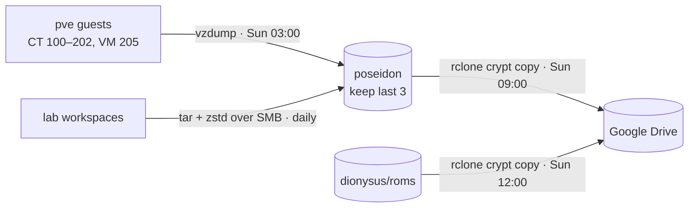

# Backups

Three layers: snapshots on a separate local disk, an encrypted copy in Google Drive, and app-level dumps for the things that have databases.



## 1. Local: vzdump to `poseidon`

- Proxmox job `backup-all-weekly`: **all guests**, snapshot mode, zstd, Sunday 03:00, `keep-last=3`.
- The target is the `poseidon` pool (WD Purple), a different disk from the guests' SSD. It protects against a dead SSD or a broken guest, not against losing the whole box.
- The lab node writes its own file-level archives of its workspaces to the same pool, through a dedicated Samba share. Those are daily, with 7 daily and 4 weekly kept.

## 2. Off-site: encrypted copy to Google Drive

Both jobs run on the **NAS container (CT 202)** as systemd timers, using [rclone](https://rclone.org/) with a `crypt` remote over Google Drive. File and folder names are encrypted, so Drive only ever sees gibberish.

| Timer | Source | What it does |
| --- | --- | --- |
| `vzdump-offsite.timer` (Sun 09:00) | `/mnt/backup/dump` | Uploads any `vzdump-*` archive from the last 8 days |
| `roms-offsite.timer` (Sun 12:00) | `/mnt/roms` (~620 GB) | Incremental upload of new ROMs |

Rules I stick to:

- **Only ever `rclone copy`, never `sync`.** A mistake or a wipe on the source can never delete anything on Drive. Pruning old archives on Drive is a manual, reviewed `rclone delete --min-age 30d`, run with `--dry-run` first.
- The upload waits until 09:00 because the weekly vzdump has finished as late as ~06:00. `flock` stops two runs from overlapping.
- `--drive-stop-on-upload-limit` makes rclone stop cleanly at Google's ~750 GB/day cap. The next run picks up where it left off.
- Verify with `rclone cryptcheck`, not `rclone check`, which doesn't work on crypt remotes.
- My own Google Cloud OAuth client is used, with the app published to production so the token doesn't expire every 7 days.

### Key custody

The vzdump archives include Vaultwarden itself, so **the crypt keys can't live only in Vaultwarden**. The keys for the ROMs and vzdump remotes are different, and both have an offline copy. Losing the crypt password and salt means losing the backup.

### Restore drill

Tested in October 2026:

```bash
rclone copy gdrive-crypt-vzdump: ./restore --include "vzdump-lxc-101-*"   # download + decrypt
zstd -t ./restore/*.tar.zst                                               # integrity
pct restore 999 <archive> --storage local-lvm --unique 1                  # restore to a spare VMID
pct set 999 --delete net0                                                 # no clash with the live CT
pct start 999 && pct destroy 999 --purge                                  # boot it, then throw it away
```

## 3. App-level dumps

| App | How |
| --- | --- |
| Gitea | `gitea dump` nightly (systemd timer inside CT 121), 7 days kept, which also lands in the weekly vzdump |
| Jellystat | Built-in backup volume |
| Vaultwarden, Nextcloud, Immich | Covered by the weekly vzdump. Database-aware dumps are still on the to-do list |

## Gaps (being honest)

- [ ] `zeus` main data (~2 TB) has **no off-site copy**. Only guests and ROMs leave the house
- [ ] No mirrored pools, so a disk failure always means a restore
- [ ] Database-consistent dumps for Nextcloud, Immich and Vaultwarden
