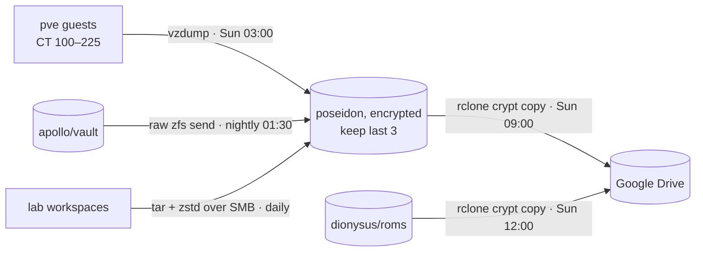

# Backups

Three layers: snapshots and a nightly replica on a separate local disk, an encrypted copy in Google Drive, and app-level dumps for the things that have databases.



## 1. Local: vzdump to `poseidon`

- Proxmox job `backup-all-weekly`: **all guests**, snapshot mode, zstd, Sunday 03:00, `keep-last=3`.
- The target is the `poseidon` pool (WD Purple), a different disk from the guests' SSD. It protects against a dead SSD or a broken guest, not against losing the whole box.
- What's in a guest backup: its rootfs, which is where every config, database and app data directory lives (`/opt/appdata` on the Docker CTs). The bind-mounted datasets (media, photos, cloud, ROMs) are **not** in vzdump; Proxmox skips bind mounts.
- `poseidon/backup` is encrypted and the storage is marked `is_mountpoint 1`. If the box rebooted and nobody has unlocked it yet, the job fails, and that failure gets mailed, instead of writing backups to the empty directory on the root SSD.
- The lab node writes its own file-level archives of its workspaces to the same pool, through a dedicated Samba share. Those are daily, with 7 daily and 4 weekly kept.

### Nightly vault replica: [`zfs-replicate-vault`](../pve/host/zfs-replicate-vault)

`apollo/vault` (photos, Nextcloud, personal files) is bind-mounted data, so vzdump never sees it. A host timer copies it to `poseidon/replica/vault` every night instead.

- [`zfs-replicate-vault.timer`](../pve/host/zfs-replicate-vault.timer) runs daily at **01:30** (`Persistent=true`), before the SMART short tests, the Sunday vzdump and the antivirus scan. The [service](../pve/host/zfs-replicate-vault.service) runs at idle I/O priority.
- Each run takes a recursive snapshot `repl-YYYYMMDD-HHMM`, then `zfs send -w -R` (incremental from the newest snapshot both sides share, matched by guid) into `zfs recv -u`.
- **Raw send**: the stream and the replica stay aes-256-gcm encrypted. The replica's key is never loaded on `poseidon`, so it's never mounted there; `homelab-unlock` only loads its three named roots.
- **Never `recv -F`.** If the two sides share no snapshot, the job refuses and mails instead of rolling the replica back.
- Keeps 7 snapshots on `apollo` and 30 on `poseidon`. Pruning only touches snapshots that match the script's name pattern **and** carry its `homelab:repl` user property, so a hand-made snapshot is never destroyed.
- Any failure mails root with the `[homelab]` prefix, like everything else ([alerts](../pve/README.md#alerts)).

It protects against deleting files or a dead `apollo` disk. It's still the same box, so the off-site copy below is the next step.

## 2. Off-site: encrypted copy to Google Drive

Both jobs run on the **NAS container (CT 202)** as systemd timers, using [rclone](https://rclone.org/) with a `crypt` remote over Google Drive. File and folder names are encrypted, so Drive only ever sees gibberish.

| Timer | Source | What it does |
| --- | --- | --- |
| `vzdump-offsite.timer` (Sun 09:00) | `/mnt/backup/dump` | Uploads any `vzdump-*` archive from the last 8 days |
| `roms-offsite.timer` (Sun 12:00) | `/mnt/roms` (~566 GB) | Incremental upload of new ROMs |

Rules I stick to:

- **Only ever `rclone copy`, never `sync`.** A mistake or a wipe on the source can never delete anything on Drive. Pruning old archives on Drive is a manual, reviewed `rclone delete --min-age 30d`, run with `--dry-run` first.
- The upload waits until 09:00 because the weekly vzdump has finished as late as ~06:00. `flock` stops two runs from overlapping.
- `--drive-stop-on-upload-limit` makes rclone stop cleanly at Google's ~750 GB/day cap. The next run picks up where it left off.
- Verify with `rclone cryptcheck`, not `rclone check`, which doesn't work on crypt remotes.
- My own Google Cloud OAuth client is used, with the app published to production so the token doesn't expire every 7 days.

### Key custody

The vzdump archives include Vaultwarden itself, so **the crypt keys can't live only in Vaultwarden**. The keys for the ROMs and vzdump remotes are different, and both have an offline copy. Losing the crypt password and salt means losing the backup.

### Restore drill

Tested in October 2026:

```bash
rclone copy gdrive-crypt-vzdump: ./restore --include "vzdump-lxc-101-*"   # download + decrypt
zstd -t ./restore/*.tar.zst                                               # integrity
pct restore 999 <archive> --storage local-lvm --unique 1                  # restore to a spare VMID
pct set 999 --delete net0                                                 # no clash with the live CT
pct start 999 && pct destroy 999 --purge                                  # boot it, then throw it away
```

## 3. App-level dumps

| App | How |
| --- | --- |
| Gitea | `gitea dump` nightly (systemd timer inside CT 121), 7 days kept, which also lands in the weekly vzdump |
| Jellystat | Built-in backup volume (`/opt/appdata/jellystat/backup-data`, inside the vzdump) |
| Immich | Built-in nightly database dump into `/photos/backups`, next to the photos it describes |
| Vaultwarden, Nextcloud | Covered by the weekly vzdump. Database-aware dumps are still on the to-do list |

## What is deliberately not backed up

The media library and downloads in `zeus/data`. Everything there can be downloaded again, and the arr apps' databases (in the vzdump) know exactly what was there.

## Gaps (being honest)

- [x] `apollo/vault` has a nightly raw replica on `poseidon` (above)
- [ ] `apollo/vault` has **no off-site copy yet**
- [ ] No mirrored pools, so a disk failure always means a restore
- [ ] Database-consistent dumps for Nextcloud and Vaultwarden
