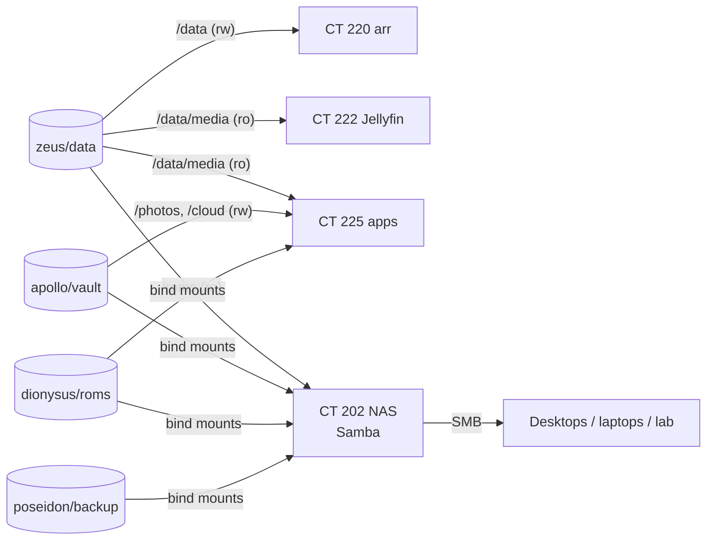

# Storage

Proxmox manages all storage directly with ZFS (TrueNAS was dropped a while ago). Each data disk is its own single-disk pool, named after a Greek god. In November 2026 `zeus` and `apollo` were wiped (a full zero-fill and a SMART long test) and re-created **encrypted**, with a layout built around hardlinks.

## Disks and pools

| Pool | Disk | Size | Holds | Encrypted |
| --- | --- | --- | --- | --- |
| `local-lvm` (LVM-thin) | ADATA SU650 SATA SSD | 240 GB | Proxmox root, every LXC rootfs (configs, databases, app data) | no |
| `zeus` | Seagate IronWolf (CMR) | 4 TB | `zeus/data`: downloads and the media library | yes |
| `apollo` | Seagate 2.5" (SMR) | 2 TB | `apollo/vault`: photos, Nextcloud data, personal files | yes |
| `dionysus` | Toshiba 2.5" | 1 TB | ROM library | no |
| `poseidon` | WD Purple | 2 TB | `poseidon/backup`: vzdump archives for both nodes | yes |

- Pool options: `ashift=12`, `compression=lz4`, `atime=off`, `xattr=sa`, `acltype=posixacl`, `dnodesize=auto`. Pools are created on `/dev/disk/by-id/` paths.
- Encryption: `aes-256-gcm`, `keyformat=passphrase`, `keylocation=prompt`, the same passphrase on every encryption root. It's unlocked by hand after each boot with [`homelab-unlock`](../pve/).
- `zeus/data` uses `recordsize=1M` (big sequential media files).
- Media is on the CMR disk. The SMR disk gets the personal data, which is written once and rarely rewritten, and is the part that gets backed up.

> ⚠️ **No redundancy yet.** Every pool is a single disk. A disk failure means restoring from [backups](backups.md), and mirroring is on the roadmap.

## Layout

```
zeus/data                    (one dataset, so hardlinks and atomic moves work)
├─ torrents/{movies,tv,anime,music,books,comics}     qBittorrent categories
└─ media/{movies,tv,anime,music,books,comics}        arr root folders, Jellyfin libraries

apollo/vault                 (encryption root)
├─ photos                    Immich
├─ cloud                     Nextcloud data directory
└─ stuff                     personal files (SMB)
```

`torrents` and `media` are **directories, not child datasets**: a hardlink can't cross a dataset boundary. Directories are `2775` (setgid), so new files keep the shared group.

## How storage reaches guests



- **Bind mounts only** (`pct set <id> -mpN /host/path,mp=/ct/path[,ro=1]`). The guests read and write ZFS directly: no SMB, NFS or virtiofs in the data path.
- **Read-only wherever a guest only needs to read.** Jellyfin, the readers and File Browser can't change the library.
- **NAS (CT 202)** shares `data`, `stuff`, `backup` and `roms` over Samba to named users on the LAN subnet. The lab node has its own backup-only share and account.

## Ownership

All guests are **unprivileged** LXCs, so uid 1000 inside any of them is uid **101000** on the host. The datasets are owned by `101000:101000`, every container runs as uid 1000 (`PUID=1000`, or `user: 1000:1000`), and Samba forces user `pym` (1000). A file written over SMB, by an arr app or by Immich ends up with the same owner everywhere.

## Host

Host tuning, the unlock flow and the firewall are on the [node page](../pve/).
