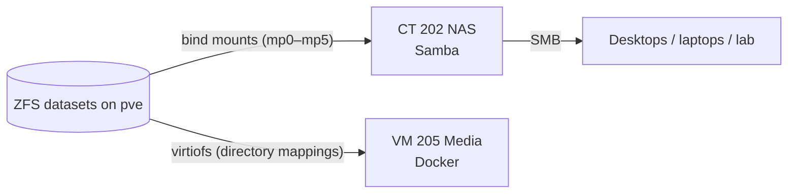

# Storage

Proxmox manages all the storage directly with ZFS (TrueNAS was dropped a while ago). Each data disk is its own single-disk pool, named after a Greek god.

## Disks and pools

| Pool | Disk | Size | Holds |
| --- | --- | --- | --- |
| `local-lvm` (LVM-thin) | ADATA SU650 SATA SSD | 240 GB | Proxmox root, every LXC rootfs, Media VM disks |
| `zeus` | Seagate IronWolf | 4 TB | Main data (movies, series, anime, music, books, comics, downloads) and app config |
| `apollo` | Seagate 2.5" | 2 TB | Encrypted `stuff` dataset: new media and downloads layout, misc files |
| `dionysus` | Toshiba 2.5" | 1 TB | ROM library |
| `poseidon` | WD Purple | 2 TB | Backups: vzdump archives for both nodes |

All datasets use `compression=lz4`, `atime=off`, `ashift=12`. Datasets passed to the VM through virtiofs also have `acltype=posix`. Without it, the VM gets `Operation not supported` when it mounts them with `expose-acl`. Each pool is scrubbed monthly.

> ⚠️ **No redundancy yet.** Every pool is a single disk. A disk failure means restoring from [backups](../backups/), and the main data pool has no off-site copy. Mirroring `zeus` is the top item on the roadmap.

## How storage reaches guests

- **NAS (CT 202, unprivileged LXC)** gets the datasets as bind mounts and shares them over Samba: `data`, `docker`, `backup`, `roms`, `media`, `downloads`. Access is limited to the LAN subnet and named users. The lab node has its own backup-only share and account.
- **Media VM (VM 205)** gets the same datasets through Proxmox **virtiofs** directory mappings (`/etc/pve/mapping/directory.cfg`), so containers read and write ZFS directly without going through SMB.
- **Ownership:** uid 1000 inside the unprivileged NAS container is uid **101000** on the host. The files are owned by 101000, so the Media VM's containers run as `PUID/PGID=101000` to match.

## Proxmox host notes

- No-subscription repository enabled. Enterprise repos disabled.
- CPU governor `powersave` with EPP `balance_performance` (amd-pstate-epp). It idles cool and still boosts under load.
- `vm.swappiness = 10`.
- Host firewall on, inbound DROP, with explicit LAN rules per guest.
